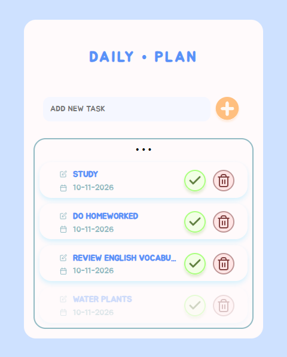
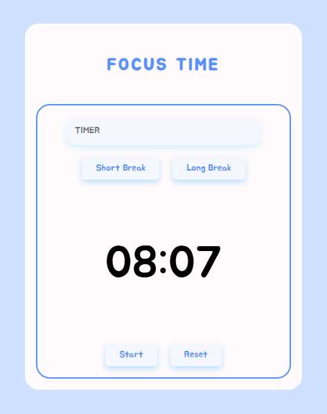

# Dailyo
 

 

|  |  |
| --- | --- |

Detalhes: Dailyo é um app com Lista de afazeres podendo Criar, Editar, Atualizar e Deletar. E o timer Pomodoro possui duas funcionalidades: pausa curta e longa. 
 
Tecnologias utilizadas: React Js, Styled Components e Vite 
 

# 🧠 About
TodoList | Timer  
 
Projetado para aumentar a produtividade e otimizar as tarefas diárias.  Mantenha o foco e aproveite ao máximo seu tempo com o cronômetro Pomodoro, uma técnica comprovada para impulsionar a produtividade.  
 

# 🕹️ Features
 TodoList: Create | Read | Updade | Delete 
 Pomodoro Timer: Short | Long break 
 

# 📋 Requirements
• vite@latest 
• styled-components 
 

# 🖥️ Installation
• Clone este repositório  
• Acesse a pasta do projeto  
• Instale as dependências 
• npm install 
• npm run dev 
